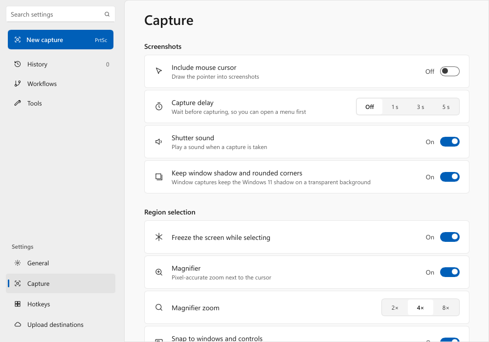
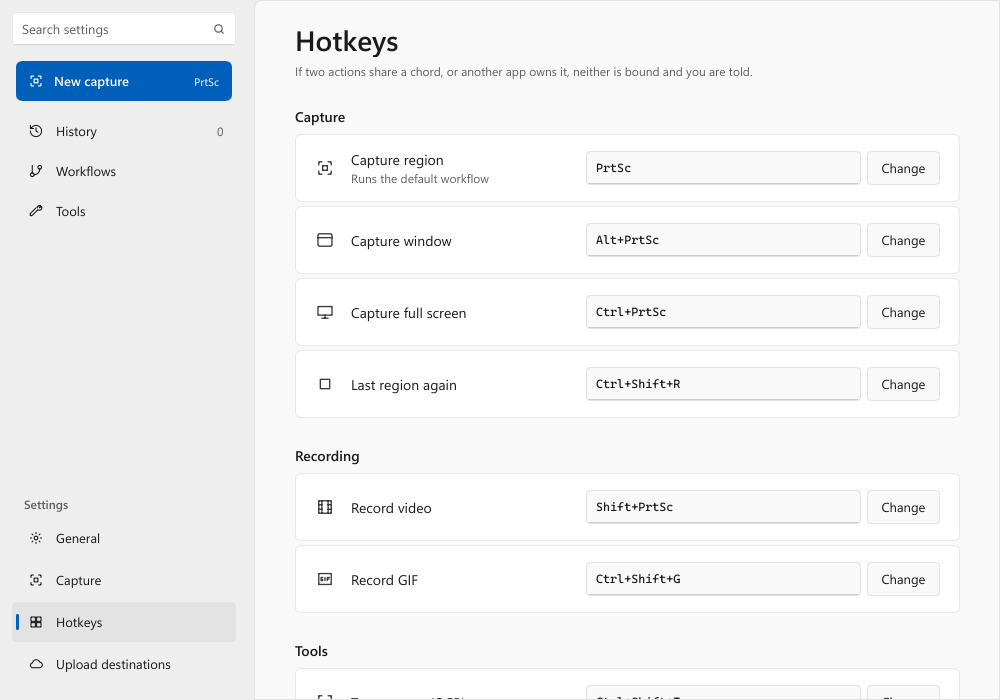
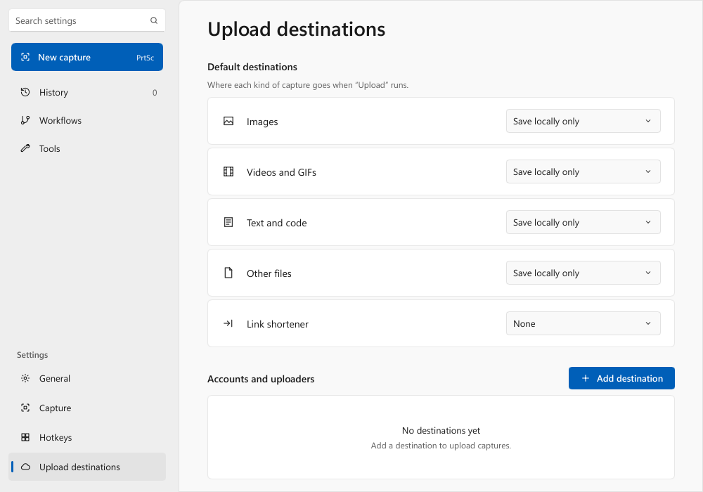

# Snapline

[](https://github.com/aaronburt/snapline/actions/workflows/ci.yml?query=branch%3Amain)
[](https://github.com/aaronburt/snapline/releases/latest)
[](https://github.com/aaronburt/snapline/releases)
[](LICENSE)
-0078D4)
[](https://github.com/aaronburt/snapline/commits/main)

A lightweight Windows tray app for screenshots and screen recordings. Capture a region, window or screen, annotate it, save it, upload it and copy the link.

- Screenshots and recordings (video or GIF through FFmpeg)
- Annotation tools
- Uploads to S3-compatible storage, SFTP, GitHub Gist and custom `.sxcu` destinations
- Capture history, global hotkeys and a tray icon

Windows 10 or 11 (x64) only. Releases are on the GitHub releases page; the installer is not code signed, so SmartScreen may warn.

## Screenshots





## Memory use


CI measures every release and the chart updates itself. The raw numbers are in [`memory.json`](https://github.com/aaronburt/snapline/blob/metrics/memory.json) on the `metrics` branch, with the commit, build profile and runner details for each entry.

How it is measured: the release `snapline.exe` runs in portable mode on a GitHub-hosted `windows-latest` runner (a virtual machine without a GPU, so figures on a real PC will differ). The script waits for the tray to settle, then reads the process's private working set at three fixed points: tray idle, main window open, and main window closed (the app trims its memory shortly after the window closes). Each figure is the median of five readings one second apart. The chart plots idle and main window open; closed is in the data file. The capture overlay is not measured, because the overlay never appears on a hosted runner. The script is [`.github/scripts/measure-memory.ps1`](.github/scripts/measure-memory.ps1).

## Build

Needs the Rust toolchain in `rust-toolchain.toml`, and NSIS (`winget install NSIS.NSIS`) for the installer.

```
cargo xtask fetch-ffmpeg
cargo build -p snapline
cargo xtask package
```

`package` builds the release exe, the NSIS installer and a portable zip.

## Test

```
cargo test --workspace
cargo clippy --workspace --all-targets
```

## Privacy

Snapline does not track you. There is no telemetry, analytics or account, and nothing about you or how you use the app is collected. Captures, history and settings stay on your PC.

The app only touches the network when you ask it to:

- **Check updates** (the button on the General page) sends one request to GitHub's releases API. It never runs on its own, not even at startup. It downloads nothing; it compares the version and links to the release page. GitHub sees your IP address and the app version, as with any web request.
- **Uploads** go only to the destinations you set up (S3-compatible storage, SFTP, GitHub Gist, custom).
- **Crash reports** are never sent automatically. After a crash, Snapline offers to open a prefilled GitHub issue in your browser, and nothing is sent until you press Submit. Your user name and personal paths are removed.
- Links you click open in your browser.

The only contact between you and me is through GitHub, such as issues and releases.

## Licence

GPL-3.0-or-later. See `LICENSE`.
